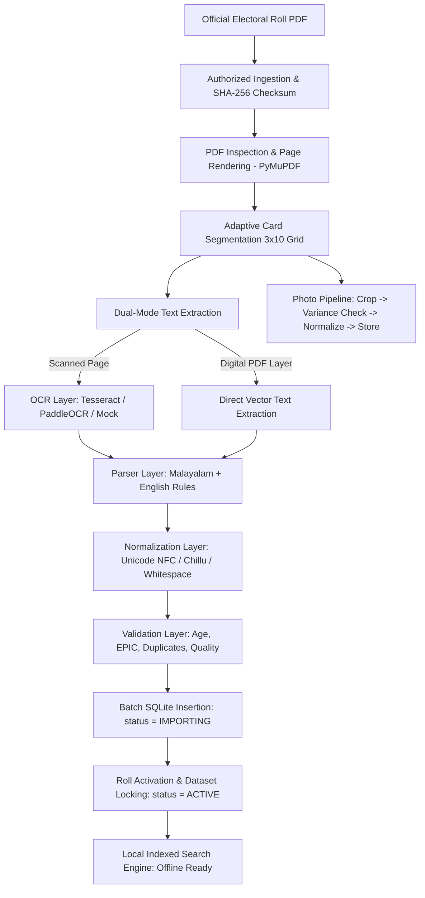

# VoterLens System Architecture — Phase 1

## 1. Architectural Philosophy
VoterLens is designed as a localized, **offline-first** electoral-roll search and field-verification application. The foundation is built upon two core principles:

1. **Strict Offline Autonomy:**
   After an authorized electoral roll has been imported into the local SQLite database, the system must never require an active internet connection to search, filter, or retrieve voter records and photographs.

2. **Absolute Separation of Official vs. Field Data:**
   - **Official Electoral Roll Data:** READ-ONLY, immutable, and locked upon roll activation. No ordinary application function may modify or delete official fields (name, age, relative, house number, EPIC).
   - **Local Field-Verification Data:** Fully editable and auditable in separate tables (`field_status` and `field_status_history`). Even observations like `REPORTED_DECEASED` or `AWAY` are stored purely as audit records, never altering the official electoral roll record.

---

## 2. High-Level Pipeline Architecture

---

## 3. Core Modules

| Module | Responsibility |
| :--- | :--- |
| `voterlens.config` | Settings, directory structures, and configurable thresholds. |
| `voterlens.downloader` | Source verification, existence checks, and SHA-256 checksum audit logging. |
| `voterlens.pdf` | PDF inspection, 200/300 DPI rendering, grid segmentation, and text layer extraction. |
| `voterlens.ocr` | Modular OCR abstraction (`BaseOCREngine`, `TesseractOCREngine`, `PaddleOCREngine`, `MockOCREngine`). |
| `voterlens.parser` | Multi-pass regex and layout parser capable of extracting Malayalam and English voter cards. |
| `voterlens.normalizer` | Preserves original official text while creating standardized searchable tokens (NFC, Chillu letter normalization). |
| `voterlens.validator` | Comprehensive pre-commit sanity check (missing fields, duplicate EPICs, impossible ages, validation report generation). |
| `voterlens.photographs` | Card portrait extraction, pixel variance validation, portrait normalization, and deterministic local storage. |
| `voterlens.database` | SQLite database manager, SQLAlchemy models, repository abstractions, and strict immutability guards. |
| `voterlens.pipeline` | Transactional coordinator executing stages with fail-safe rollback guarantees. |

---

## 4. Roll Lifecycle & Activation Guarantees

Electoral rolls transition through well-defined lifecycle states:
- `IMPORTING`: Staging state where voter records are being inserted. Only one import runs at a time.
- `ACTIVE`: The single authoritative active roll for a given area (`state`, `district`, `assembly_constituency`). Dataset is locked and immutable.
- `ARCHIVED`: Previous roll versions that were superseded by newer imports. Retained for historical comparison and audit.
- `FAILED`: Import runs that failed validation or threw exceptions. **The existing `ACTIVE` roll remains completely untouched.**

---

## 5. Security & Compliance
- **No Hardcoded Credentials:** The codebase contains zero passwords, secrets, or API tokens.
- **No Bypass Mechanisms:** The system operates purely on locally-provided authorized electoral rolls.
- **Privacy Assurance:** Automated tests use synthetic, non-real person data.
