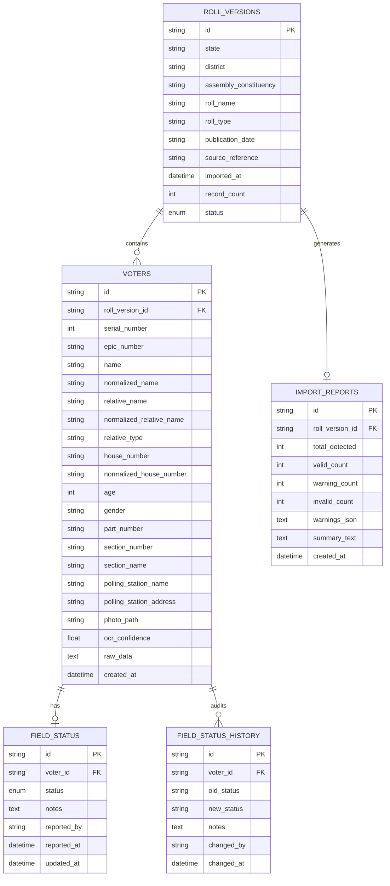

# VoterLens Data Model Specification

## 1. Relational Schema Overview

VoterLens utilizes a normalized, indexed SQLite database configured with Write-Ahead Logging (`PRAGMA journal_mode=WAL`), foreign key enforcement (`PRAGMA foreign_keys=ON`), and synchronous writes (`PRAGMA synchronous=NORMAL`).

---

## 2. Table Specifications

### 2.1 `roll_versions`
Stores metadata and lifecycle state for each imported roll publication.
- `status`: Enum (`IMPORTING`, `ACTIVE`, `ARCHIVED`, `FAILED`).
- Invariant: Only **one** roll version may be `ACTIVE` for a specific `(state, district, assembly_constituency)` tuple.

### 2.2 `voters`
Official electoral roll records.
- **Original vs. Normalized Fields:** `name` and `relative_name` store original Malayalam or English strings as published; `normalized_name` and `normalized_relative_name` store uppercase, Unicode-normalized (NFC + Chillu letter unified) strings for rapid search indexing.
- **Forward Compatibility:** `raw_data` JSON field allows new roll columns (e.g., Aadhaar linkage status, overseas marker) to be captured without altering table DDL.
- **Immutability:** Repository layer blocks direct updates or deletions of voter records once the parent roll is `ACTIVE`.

### 2.3 `field_status`
Local observations recorded by booth-level workers during door-to-door verification.
- Completely separate table from `voters`.
- Status types:
  - `NO_ISSUE` (Default)
  - `AWAY` (Temporarily away / relocated)
  - `ABROAD` (Living overseas)
  - `REPORTED_DECEASED` (Audited observation; does **not** delete or mutate the voter record)
  - `UNABLE_TO_VERIFY`

### 2.4 `field_status_history`
Append-only chronological audit log of all status transitions. Every change in `field_status` creates a history row capturing `old_status`, `new_status`, `changed_by`, `notes`, and `changed_at`.

### 2.5 `import_reports`
Archived snapshot of validation metrics and warnings generated during import.

---

## 3. Search Indexing Strategy
To guarantee fast offline queries across tens of thousands of voters, the following B-Tree indexes are created:
- `ix_voter_name` and `ix_voter_norm_name`
- `ix_voter_epic`
- `ix_voter_rel_name` and `ix_voter_norm_rel_name`
- `ix_voter_house`
- `ix_voter_part`
- `ix_voter_serial`
- `ix_voter_gender`
- Compound index `ix_voter_roll_epic (roll_version_id, epic_number)`
- Compound index `ix_voter_roll_part_serial (roll_version_id, part_number, serial_number)`
