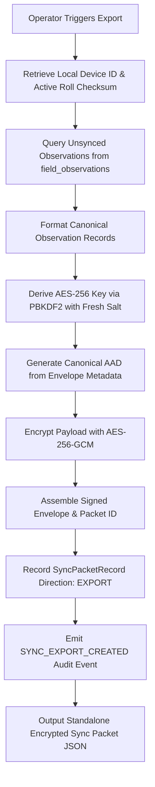
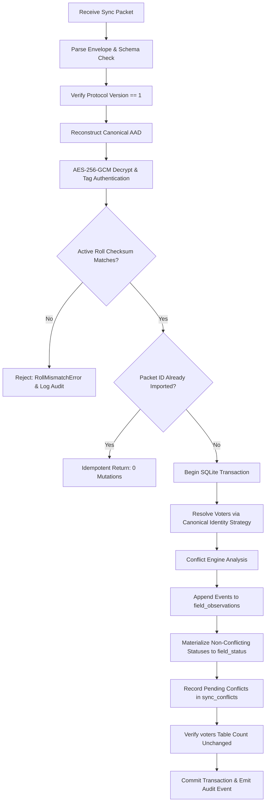
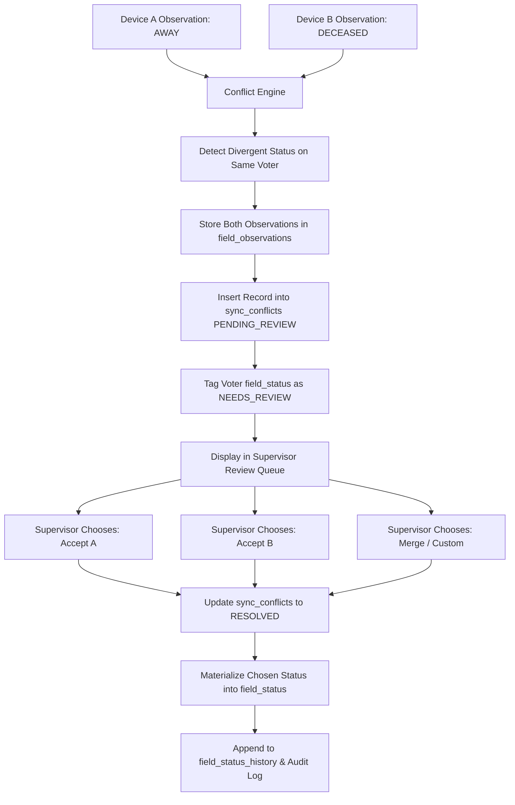

# VoterLens — Offline Synchronization Architecture

## 1. Executive Summary & Core Principle

VoterLens operates in disconnected, localized field environments where polling-station workers, booth agents, and supervisors must exchange field observations without relying on centralized cloud servers or internet infrastructure.

The core principle governing the synchronization layer is:

> **"Exchange and reconcile local field observations only. Never synchronize, modify, or export the statutory electoral roll."**

---

## 2. Non-Negotiable Data Boundary

The VoterLens data architecture strictly isolates two fundamentally distinct classes of data:

```
┌─────────────────────────────────────────────────────────────────────────┐
│                     CLASS A: OFFICIAL ELECTORAL DATA                    │
│   - Voter Name (English & Malayalam)       - Section & Part Numbers     │
│   - EPIC Identification Number             - Polling Station Details    │
│   - Relative Name & Relation Type          - Official Serial Numbers    │
│   - House Number & Normalized House Number - Official Photo Hashes      │
│   - Age & Gender                           - Roll Checksum & Gazette    │
│                                                                         │
│   STATUS: STRICTLY IMMUTABLE (Read-Only)                                │
│   SYNCHRONIZATION POLICY: NEVER EXPORTED, NEVER OVERWRITTEN, NEVER MERGED │
└────────────────────────────────────┬────────────────────────────────────┘
                                     │ Linked by Canonical Voter Identity
                                     │ (roll_checksum, epic_number)
┌────────────────────────────────────▼────────────────────────────────────┐
│                      CLASS B: LOCAL FIELD DATA                          │
│   - Verification Status (No Issue, Away, Abroad, Deceased, Unverified)  │
│   - Contact Phone Number (Local Field Observation)                      │
│   - Field Operational Notes                                             │
│   - Review Queue Status & Anomaly Flags                                 │
│   - Observation Provenance (Origin Device, Author, Timestamp)           │
│   - Audit Trail & Status Transition History                             │
│                                                                         │
│   STATUS: SYNCHRONIZABLE LOCAL OBSERVATIONS                             │
│   SYNCHRONIZATION POLICY: EXCHANGED, AUTHENTICATED & RECONCILED         │
└─────────────────────────────────────────────────────────────────────────┘
```

Under zero circumstances will any sync operation execute `INSERT`, `UPDATE`, or `DELETE` statements against the `voters` or `roll_versions` database tables.

---

## 3. Observation Event Store vs. Current Materialized State

A common flaw in distributed offline systems is treating the current row in `field_status` as the entire state history, leading to destructive overwrites when two devices sync divergent observations. VoterLens solves this by adopting a **Lightweight Event Store Model**:

1. **Discrete Observation Stream (`field_observations`)**:
   - Represents: *"What happened?"*
   - Append-only event store recording every observation generated on any device.
   - Preserves original author, origin device ID, observation timestamp, and superseding chains.
2. **Materialized Current State (`field_status`)**:
   - Represents: *"What is the latest accepted/resolved state for voter X?"*
   - High-speed indexed view queried by the UI, list filters, search engine, and analytics dashboards.
   - Updated deterministically upon accepting clean observations or following supervisor resolution.

---

## 4. End-to-End Architecture Diagrams

### A. Export Flow



---

### B. Import Flow (14-Stage Atomic Pipeline)



---

### C. Conflict Reconciliation Flow



---

## 5. Transport Independence

The synchronization packet is a self-contained, cryptographically authenticated JSON artifact that is completely decoupled from the transport medium. The identical packet can be transported across:

1. **Local Encrypted File Transfer**: Saved to micro-SD card or external USB flash drive.
2. **Direct Peer-to-Peer**: Transferred via Wi-Fi Direct or Bluetooth RFCOMM (Phase 4B).
3. **High-Density Chunked QR Codes**: For small observation batches (1–20 records) displayed screen-to-camera.
4. **Air-Gapped Workstation Hub**: Imported through desktop supervisor consoles.

The sync engine treats all transports identically: a stream of validated bytes entering the 14-stage atomic pipeline.

---

## 6. Phase Architecture Evolution: Phase 4A vs. Phase 4B

```
┌────────────────────────────────────────────────────────────────────────┐
│                   PHASE 4A: SYNCHRONIZATION ARCHITECTURE               │
│ - Canonical Voter Identity: (roll_checksum, epic_number)               │
│ - Event-driven append-only observation stream (field_observations)    │
│ - Materialized field status (field_status)                             │
│ - AES-256-GCM authenticated encryption & PBKDF2-HMAC-SHA256 KDF        │
│ - Strict AAD authentication & deterministic packet serialization      │
│ - Conflict classification engine & supervisor review workflow         │
│ - Statutory official data immutability enforcement                     │
└───────────────────────────────────┬────────────────────────────────────┘
                                    │ Transport Abstraction
                                    │ (SyncTransport interface)
┌───────────────────────────────────▼────────────────────────────────────┐
│              PHASE 4B: ENCRYPTED LOCAL .VLSYNC FILE TRANSPORT          │
│ - Reference implementation of SyncTransport: VLSyncFileTransport       │
│ - File container format: magic ('VLSYNC'), version, metadata, GCM      │
│ - Atomic file export with SHA-256 integrity digest                     │
│ - Two-stage import workflow (Inspect/Preview → Atomic Commit)          │
│ - Gazette Snapshot & Field Delta Backup / Restore                      │
│ - iOS-style Flutter Sync Center, Import Preview, & Conflict UI         │
│ - Role-based authorization & comprehensive tamper-rejection tests      │
└────────────────────────────────────────────────────────────────────────┘
```

Phase 4B serves as the reference transport implementation. Future transports (Phase 4C: Dynamic QR, Bluetooth RFCOMM, Wi-Fi Direct) directly reuse the identical packet serialization, cryptographic envelope, and reconciliation engine established here without architectural modifications.

