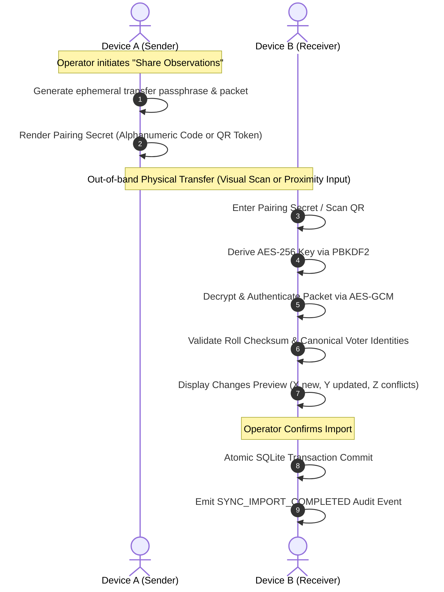

# VoterLens — Synchronization Security & Key Management

## 1. Cryptographic Architecture & Primitives

VoterLens adopts modern, audited, industry-standard cryptographic primitives to ensure confidentiality, integrity, and authenticity of all offline synchronization exchanges.

```
┌─────────────────────────────────────────────────────────────┐
│                    CRYPTOGRAPHIC STACK                      │
├─────────────────────────┬───────────────────────────────────┤
│ Symmetric Cipher        │ AES-256-GCM (Galois/Counter Mode) │
├─────────────────────────┼───────────────────────────────────┤
│ Key Length              │ 256 bits (32 bytes)               │
├─────────────────────────┼───────────────────────────────────┤
│ Key Derivation (KDF)    │ PBKDF2 with HMAC-SHA256           │
├─────────────────────────┼───────────────────────────────────┤
│ KDF Iterations          │ 100,000 rounds                    │
├─────────────────────────┼───────────────────────────────────┤
│ Salt Size               │ 128 bits (16 bytes random)        │
├─────────────────────────┼───────────────────────────────────┤
│ Nonce / IV Size         │ 96 bits (12 bytes unique random)  │
├─────────────────────────┼───────────────────────────────────┤
│ Authentication Tag      │ 128 bits (16 bytes GCM tag)       │
├─────────────────────────┼───────────────────────────────────┤
│ Header Binding          │ Additional Authenticated Data     │
└─────────────────────────┴───────────────────────────────────┘
```

---

## 2. Key Derivation & Nonce Discipline

1. **PBKDF2-HMAC-SHA256**:
   - High work factor protects against offline dictionary and rainbow-table attacks if a transfer file is intercepted.
   - Every packet generates a new 16-byte cryptographically secure pseudorandom salt (`secrets.token_bytes(16)`), ensuring that identical passphrases generate distinct derived keys across transfers.
2. **Strict Nonce Uniqueness**:
   - AES-GCM security relies on never reusing a nonce with the same key.
   - VoterLens generates a fresh 96-bit cryptographically secure random nonce for every individual packet export. Combined with per-packet salt rotation, nonce collision risk is mathematically infinitesimal ($< 2^{-48}$).

---

## 3. Key Management Lifecycle

```
    ┌──────────────────────┐
    │ 1. KEY GENERATION    │  Supervisor or device creates high-entropy secret
    └──────────┬───────────┘
               │
    ┌──────────▼───────────┐
    │ 2. SECURE STORAGE    │  Stored in OS secure keystore (Keychain/KeyStore/DPAPI)
    └──────────┬───────────┘
               │
    ┌──────────▼───────────┐
    │ 3. OUT-OF-BAND EXCH. │  Exchanged via physical presence / pairing secret
    └──────────┬───────────┘
               │
    ┌──────────▼───────────┐
    │ 4. KEY ROTATION      │  Rotated per operational shift or part reassignment
    └──────────┬───────────┘
               │
    ┌──────────▼───────────┐
    │ 5. KEY REVOCATION    │  Compromised device IDs revoked in trusted_devices
    └──────────────────────┘
```

### Detailed Lifecycle Rules:
* **Storage Rules**: Keys, transfer passphrases, and pairing tokens must **NEVER** be stored in:
  - Git version control.
  - Plaintext configuration files.
  - Database text fields.
  - Unencrypted application cache.
* **Device Revocation**: If a field device is lost or compromised, administrators mark the unit's `device_id` as `is_trusted = False` in `trusted_devices`. Even if the possessor knows the transfer passphrase, packets bearing that `source_device_id` will be rejected by the validation pipeline.

---

## 4. Pairing Model Specification (Phase 4B Blueprint)

Phase 4A designs the cryptographic pairing protocol that subsequent UI phases will implement:



---

## 5. Zero-Cloud Offline Boundary Guarantees

* **Zero Outbound Sockets**: The application initiates zero HTTP, WebSocket, DNS, or UDP socket connections during export or import.
* **No Telemetry / Crash Reporting Leakage**: Error reporting and diagnostic logs stay strictly local in SQLite WAL storage.
* **Deterministic Air-Gapped Operation**: All cryptographic primitives are executed in-process using local machine resources (`package:sqlite3` in Dart; `cryptography` in Python).
