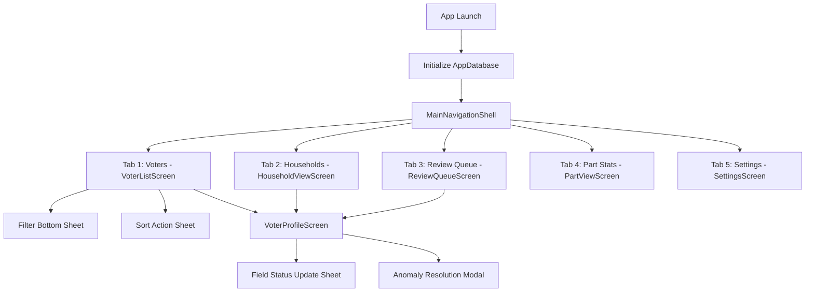

# VoterLens — UI Architecture Specification

## 1. Overview & Architectural Principles

The VoterLens user interface is designed as an iOS-inspired, utility-first mobile application optimized for high-density, field-operational electoral roll inspection and observation recording. It adheres strictly to the following fundamental constraints:

1. **Zero Network Connectivity**: 100% offline operation via in-process SQLite access (`package:sqlite3/sqlite3.dart`). Zero HTTP requests, WebSocket connections, or background daemon processes.
2. **Statutory Immutability**: Official electoral data (`voters`, `roll_versions`) is strictly read-only and visually segregated from local field observations (`field_status`, `field_status_history`).
3. **Audit History Tracking**: Every field status change generates an append-only audit trail entry recording old status, new status, timestamp, operator role, and optional notes.
4. **Zero Photo Fabrication**: When no verified portrait photo is present, a clean neutral vector silhouette is displayed with zero simulated avatars or synthetic assets.

---

## 2. Layered Architecture Topology

The application follows Clean Architecture principles divided across four isolated layers:

```
┌─────────────────────────────────────────────────────────────┐
│                    Presentation Layer                       │
│  - Screens: VoterList, VoterProfile, ReviewQueue, etc.      │
│  - Widgets: StatusBadge, VoterCard, SearchBar, Sheets       │
│  - Riverpod StateNotifier & Provider reactive bindings      │
└──────────────────────────────┬──────────────────────────────┘
                               │ Observes / Calls
┌──────────────────────────────▼──────────────────────────────┐
│                       Domain Layer                          │
│  - Entities: Voter, FieldStatusRecord, Household, Roll      │
│  - Repositories: VoterRepository, RollRepository interfaces │
│  - Criteria: FilterCriteria, SortBy, SortOrder              │
└──────────────────────────────┬──────────────────────────────┘
                               │ Implements
┌──────────────────────────────▼──────────────────────────────┐
│                        Data Layer                           │
│  - VoterRepositoryImpl, RollRepositoryImpl                  │
│  - Mapping: SQLite rows <──> Domain Entities               │
└──────────────────────────────┬──────────────────────────────┘
                               │ Executes In-Process SQL
┌──────────────────────────────▼──────────────────────────────┐
│                        Core Layer                           │
│  - AppDatabase (SQLite FFI, WAL mode, foreign keys)         │
│  - Design Tokens: AppColors, AppTypography, AppTheme        │
│  - Constants: FieldStatusType, ReviewStatusType, UserRole   │
└─────────────────────────────────────────────────────────────┘
```

---

## 3. Screen Hierarchy & Navigation Flow

The root layout is orchestrated by `MainNavigationShell` (`lib/app/app.dart`) employing a persistent 5-tab `BottomNavigationBar` backed by an `IndexedStack` to preserve scroll positions, filter states, and active form inputs across tab transitions.



### Detailed Screen Specifications:

1. **Voters (`VoterListScreen`)**:
   - Header with active roll title and live filtered count pill.
   - Quick Filter Chips Bar (`All`, `Away`, `Abroad`, `Deceased`, `Unable to Verify`, `Needs Review`).
   - Debounced Search Bar (`EPIC`, `Malayalam Name`, `English Name`, `House Number`, `Relative Name`).
   - Virtualized `ListView.builder` rendering `VoterCard` widgets with micro-interactions.
2. **Households (`HouseholdViewScreen`)**:
   - Prominent disclaimer banner: *"Grouped by normalized house number — organizational convenience only."*
   - Collapsible/expandable household groupings displaying member counts and individual voter rows.
3. **Review Queue (`ReviewQueueScreen`)**:
   - Badge counter on tab icon reflecting flagged review backlog.
   - List of anomaly-flagged voter cards with highlighted trigger reasons (e.g., status conflict, duplicate EPIC).
   - Supervisor/Manager inline review approval dialog with audit signoff.
4. **Part & Booth Analytics (`PartViewScreen`)**:
   - Booth hierarchy metadata (Constituency, Part Number, Polling Station location).
   - Gender demographic breakdown with percentage meters.
   - Field observation coverage progress bar (`No Issue`, `Away`, `Abroad`, `Deceased`, `Unverified`).
5. **Settings & Diagnostics (`SettingsScreen`)**:
   - Active roll metadata (Constituency, District, State, Record Count, Statutory Lock).
   - SQLite WAL engine diagnostics and offline verification indicators.
   - RBAC Operator switcher (`Admin`, `Manager`, `Field Operator`, `Viewer`) dynamically constraining permissions.
   - Theme switchers (`System`, `Light`, `Dark`).

---

## 4. State Management with Riverpod

State management is structured reactively using Riverpod:

| Provider | Type | Responsibility |
| :--- | :--- | :--- |
| `databaseProvider` | `Provider<AppDatabase>` | Singleton in-process SQLite database connection |
| `userRoleProvider` | `StateProvider<UserRole>` | Current active RBAC operator role |
| `themeModeProvider` | `StateProvider<ThemeMode>` | Theme switching mode (`system`, `light`, `dark`) |
| `activeRollProvider` | `Provider<RollVersion?>` | Active electoral roll metadata |
| `filterCriteriaProvider` | `StateNotifierProvider<FilterNotifier, FilterCriteria>` | Live search query, filters, sorting, and pagination state |
| `voterListProvider` | `Provider<List<Voter>>` | Reactive voter list recomputed on filter criteria changes |
| `voterTotalCountProvider` | `Provider<int>` | Total match count for filtered criteria |
| `reviewQueueProvider` | `StateNotifierProvider<ReviewQueueNotifier, List<Voter>>` | Flagged review records with stateful resolution actions |
| `householdListProvider` | `Provider<List<Household>>` | Aggregated household groups based on normalized house numbers |
| `areaStatsProvider` | `Provider<AreaStatistics?>` | Demographic and field status distribution for the active part |

---

## 5. Offline Image Rendering & Fallback Pipeline

Voter portrait photos follow an offline-only validation and fallback pipeline:
1. `VoterPhotoWidget` inspects `voter.photoPath`.
2. Verifies local file existence via synchronous filesystem check (`File(path).existsSync()`).
3. If valid and present: Decodes image via `Image.file(...)` with `fit: BoxFit.cover` and rounded squircle borders.
4. If missing, null, or corrupt: Renders a neutral Cupertino silhouette (`CupertinoIcons.person_fill`) against a subtle tinted surface. **No synthetic avatars, cartoons, or speculative images are ever generated.**

---

## 6. Audit Logging & Immutability Enforcement

When updating a voter's field observation:
1. The repository initiates a SQLite transaction on `AppDatabase`.
2. Inserts or updates the `field_status` table (`status`, `notes`, `phone_number`, `updated_at`, `updated_by`).
3. Inserts a row into `field_status_history` (`old_status`, `new_status`, `notes`, `changed_by`, `changed_at`).
4. **The `voters` table is never updated.** Its row remains permanently identical to the original statutory gazette import.
